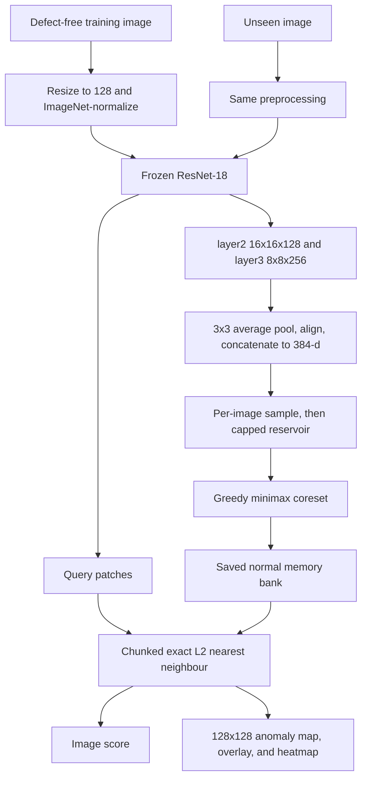

# VisionGuard

CPU-only industrial anomaly detection. VisionGuard stores local ResNet-18 features from defect-free images and scores later images by nearest-neighbour distance. It is a PatchCore-inspired memory bank, not a trained classifier and not a self-supervised fine-tuning loop.

Repository: https://github.com/Shaiza666/VisionGuard

Scores are distances. They are not probabilities. This repository does not report a measured AUROC, because MVTec AD is not included and no category memory bank has been built.

## Status

| Item | State |
| --- | --- |
| Feature extraction, memory bank, scoring, and save/load | Implemented |
| Image and pixel metrics, including an honest missing-data path | Implemented |
| Streamlit inspection dashboard | Implemented and wired to the saved bank |
| Unit tests on synthetic fixtures | 30 passed on this machine |
| MVTec AD images | Not in the repository. Download them yourself. |
| Bottle and hazelnut memory banks | Not built |
| Measured detection metrics | None. Do not quote paper numbers as results of this code. |
| VisA and other MVTec categories | Not implemented |

Published PatchCore image-level AUROC figures, including 99.6% on MVTec AD, belong to Roth et al., CVPR 2022. They are not measurements from VisionGuard.

## System architecture



The backbone stays frozen. Test images and defect masks are not used while the bank is built. Module roles are listed in `docs/architecture.md`.

## Installation

Windows 10, Python 3.12, 8 GB RAM, and no NVIDIA GPU. The requirements file installs CPU wheels from the PyTorch CPU index.

```text
py -3 -m venv .venv
.venv\Scripts\activate
python -m pip install --upgrade pip
python -m pip install -r requirements.txt
python -m pytest
```

Pinned packages used on the development machine: `torch==2.15.0+cpu`, `torchvision==0.29.2+cpu`, NumPy 2.5.5, Pillow 13.0.0, PyYAML 6.0.3, Streamlit 1.67.0, and pytest 9.2.0.

## Dataset

Download MVTec AD from https://www.mvtec.com/research-teaching/datasets/mvtec-ad. The license is CC BY-NC-SA 4.0. Commercial use is not allowed. The full archive is several gigabytes. VisionGuard does not download it.

Supported categories in this release are `bottle` and `hazelnut` only. Extract them so this path exists:

```text
datasets/mvtec/bottle/train/good
datasets/mvtec/hazelnut/train/good
```

Keep test images and ground-truth masks in the official test folders. Folder rules are in `docs/dataset_instructions.md`. `datasets/mvtec/` is gitignored.

Check the local layout without loading weights:

```text
python train.py --config configs/default.yaml --check
```

Until the folders exist, that command exits with code 2 and prints the official download page. It does not invent image counts.

## Training

Training here means building a normal memory bank. It does not update ResNet-18 weights.

```text
python train.py --config configs/default.yaml --category bottle
python train.py --config configs/default.yaml --category hazelnut
```

Each command uses only `train/good` for that category, one image at a time, on CPU. Progress is printed and written under `reports/logs/`. The run saves:

- `reports/memory/<category>/memory_bank.npz`
- `reports/memory/<category>/metadata.json`
- `reports/memory/<category>/config.json`

The first ImageNet run downloads torchvision ResNet-18 weights if they are not already cached. That is separate from the dataset. `model.weights: none` is for code checks with random features, not for inspection.

A full category on this CPU can take a long time. Do not start it unless the dataset is present and the machine can be left running. Defaults that keep memory bounded are in `configs/default.yaml`: 128×128 images, batch size 1, `num_workers: 0`, a reservoir of 8192 patches, and a coreset cap of 2048.

## Evaluation

```text
python evaluate.py --config configs/default.yaml --category bottle
```

The command scores the local test split with the saved bank and ground-truth masks. It writes `reports/evaluation/bottle.json`, a log, and a few localization images under `reports/figures/bottle/`.

| Metric | When it is reported |
| --- | --- |
| Image-level AUROC | Both normal and anomalous test images are present. No threshold. |
| Pixel-level AUROC | Masks exist. Large maps may be subsampled; the JSON says so. |
| Precision, recall, F1, confusion matrix | A distance cutoff is required. |
| Per-defect metrics | Each defect folder is compared with the normal test images. A defect folder alone has one class. |

If `evaluation.image_threshold` is null, the cutoff is the one that maximizes F1 on that same split. The report labels it `f1_max_on_this_split`. That cutoff saw the evaluation labels, so it is an optimistic summary, not a threshold to deploy. If a class or mask is missing, the field is null and `unavailable_reason` explains why.

## Launch the dashboard

```text
streamlit run app.py
```

Open the local URL Streamlit prints. The sidebar has Overview, Dataset, Model, Build memory, Inspect, and Evaluation. The category selector lists bottle and hazelnut.

- Dataset reads the local folder and shows the real layout error when it is missing.
- Build memory calls the same routine as `train.py` and does nothing until the button is pressed.
- Inspect loads the saved bank. Without a bank it refuses to show a score.
- A scored image shows the preprocessed original, a min-max heatmap, an overlay, and the distance score.
- Batch inspection scores files one at a time and offers JSON and Markdown downloads. Uploads have no masks, so those reports leave metrics null.
- Evaluation displays `reports/evaluation/<category>.json` only after `evaluate.py` has written it.

## Hardware and limitations

| Constraint | Choice on this machine |
| --- | --- |
| RAM | 8 GB |
| Graphics | Intel HD Graphics 520. PyTorch stays on CPU. CUDA is not used. |
| Image size | 128×128 direct resize, not the paper's 256 resize and 224 crop |
| Batch size | 1, or at most 2 |
| Workers | 0, because extra workers duplicate memory on Windows |
| Backbone | ResNet-18, not WideResNet-50 |
| Search | Exact chunked L2. No Faiss index. |
| Memory bank | Reservoir cap, then greedy coreset. The full patch matrix is not kept. |

More limits are in `docs/hardware_limitations.md`.

## Research methodology and limitations

The method follows the PatchCore idea from Roth et al., CVPR 2022: represent normality by mid-level patch features and score an image by its distance to that memory. VisionGuard changes the implementation to fit an 8 GB CPU laptop.

1. Fit one bank per category on defect-free training images only.
2. Extract frozen ImageNet ResNet-18 `layer2` and `layer3` maps.
3. Average each map with a 3×3 kernel, upsample the coarser map, and concatenate to 384 dimensions.
4. Keep a bounded random subset, then a greedy minimax coreset of the original vectors.
5. Score every query patch by its minimum L2 distance. The default image score is the maximum of those distances.
6. Upsample the patch distances to a 128×128 anomaly map. Heatmap colors are min-max scaled per image for display.

Deviations from the paper and the official code: ResNet-18 instead of WideResNet-50, 128×128 instead of 224, no neighbourhood unfold plus channel projection, a reservoir cap before the coreset, no Faiss, and Gaussian smoothing off by default (`heatmap_smooth_sigma: 0`). The paper used sigma 4 at a higher resolution.

These limits follow from that design:

- No detection number in this repository has been measured on MVTec.
- A threshold chosen on the evaluation split is optimistic.
- Pixel metrics cannot be calculated without ground-truth masks.
- Uploaded dashboard images are not an evaluation set.
- Synthetic tests check components. They are not industrial defect-detection results.
- VisA, other MVTec categories, PRO curves, and backbone training are not in this release.

The full method write-up is `docs/methodology.md`. Background, related work, and the research gap are in `docs/research_background.md`, `docs/literature_review.md`, and `docs/research_gap.md`.

## Project layout

| Path | Role |
| --- | --- |
| `models/` | Frozen ResNet-18, patch embedding, coreset, nearest-neighbour scoring |
| `training/memory_bank.py` | Incremental normal-bank construction |
| `inference/predict.py` | Load a bank and reject a config mismatch |
| `evaluation/` | AUROC, precision, recall, F1, confusion matrix, reports |
| `visualization/heatmap.py` | Overlay and heatmap images |
| `app.py` | Streamlit dashboard |
| `train.py`, `evaluate.py` | Command-line entry points |
| `configs/default.yaml` | CPU defaults |
| `tests/` | Synthetic component tests |

## Tests

```text
python -m pytest
```

The suite covers dataset layout, preprocessing, feature extraction, memory-bank construction, anomaly scoring, visualization, and evaluation decisions. Fixtures are small synthetic images and tensors. `weights: none` is used where a network is required, so the tests do not download ImageNet weights or MVTec.

## Contributors

Shaiza Asghar (Shaiza666)

GitHub profile:
https://github.com/Shaiza666
