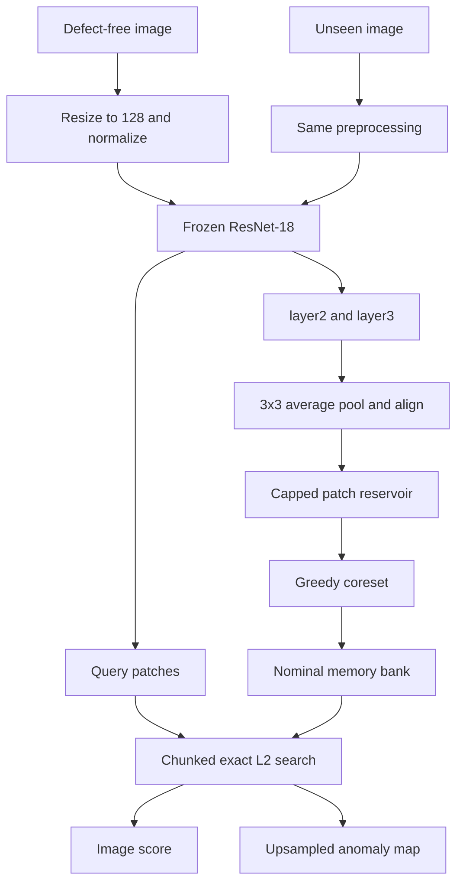

# Architecture

## Modules

| Path | Role |
| --- | --- |
| `data/layout.py` | Finds MVTec files. Does not open pixels and does not download data. |
| `data/dataset.py` | Returns one training tensor or one test sample at a time. |
| `models/extractor.py` | Frozen ResNet-18. `layer4` is not used. |
| `models/embedding.py` | Local pooling, alignment, and per-image patch sampling. |
| `models/memory.py` | Reservoir cap and greedy coreset. |
| `models/scoring.py` | Chunked nearest-neighbour distances and the image score. |
| `models/detector.py` | Extractor plus a loaded bank. |
| `training/memory_bank.py` | Streams the nominal split and writes the bank. |
| `inference/predict.py` | Loads a bank and checks that it matches the config. |
| `evaluation/` | AUROC and the evaluation report. |
| `visualization/heatmap.py` | Display overlay. |
| `app.py` | Streamlit inspection page. |
| `train.py`, `evaluate.py` | Command-line entry points. |

## What is intentionally absent

- No WideResNet-50, ViT, or other transformer backbone.
- No Faiss index and no approximate search.
- No channel-reduction projection after the neighbourhood unfold used by the official code.
- No training loop over backbone weights.
- No VisA reader.
- No stored predictions in `reports/` at setup time.

## Files written by a real run

These directories are gitignored because they depend on data that is not in the repository:

- `reports/memory/<category>/memory_bank.npz`
- `reports/memory/<category>/metadata.json`
- `reports/evaluation/<category>.json`
- `reports/figures/<category>/`

Until those files exist, the application has nothing to score.
